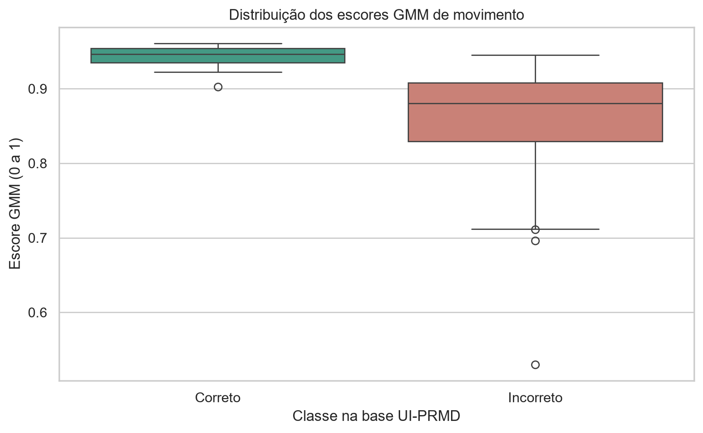
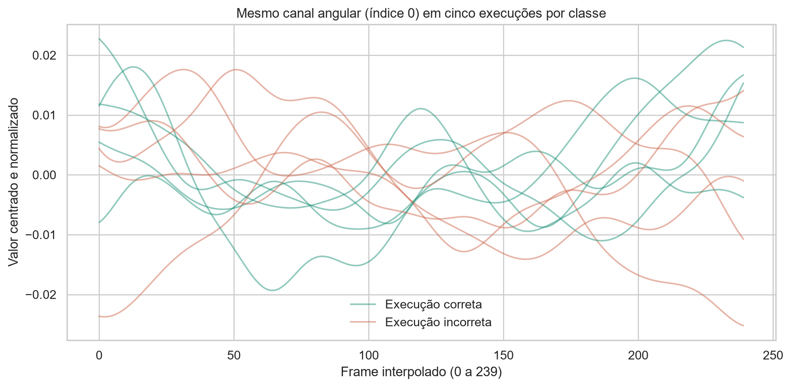
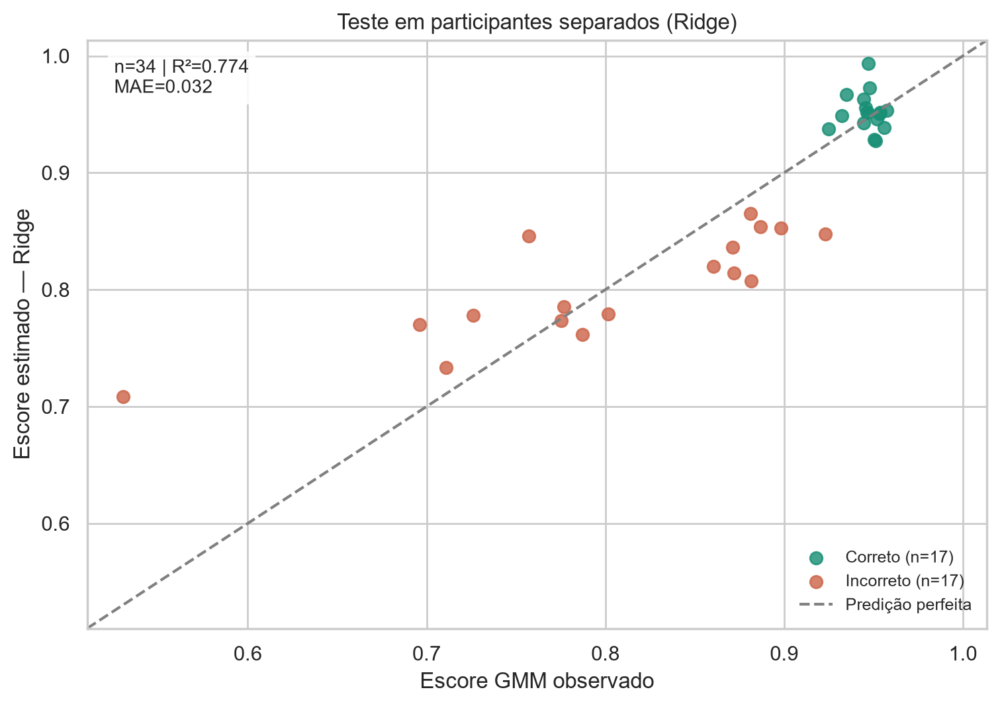

# Análise preditiva com IA para exercícios de musculação

**Universidade Presbiteriana Mackenzie · Faculdade de Computação e Informática**  
**Disciplina:** Inteligência Artificial — Sistemas de Informação, 7ºJ (noturno)  
**Professor:** Prof. Dr. Leandro Zerbinatti  
**Etapa:** Projeto da disciplina — **2º bimestre (N2), 2026**  
**Modalidade:** Opção Framework — Machine Learning com Python e scikit-learn

## Visão geral

Este projeto investiga a aplicação de **aprendizado de máquina à análise de movimentos de agachamento profundo (*Deep Squat*)**. A implementação atual realiza análise exploratória de dados cinemáticos e **estima escores estatísticos de qualidade de movimento** presentes no conjunto público UI-PRMD (*University of Idaho — Physical Rehabilitation Movement Dataset*).

O trabalho evoluiu da exploração inicial da N1 para uma avaliação preditiva na N2. A abordagem implementada utiliza **regressão Ridge**, validação com **participantes separados entre treino e teste**, seleção de regularização por validação cruzada e comparação com um modelo de referência (*baseline*).

> **Escopo efetivamente implementado:** estimativa de escores previamente calculados por **Gaussian Mixture Models (GMM)** para o exercício Deep Squat. **Não** há, nesta entrega, análise de vídeo com MediaPipe, detecção de fadiga, diagnóstico de lesões, identificação automática de erros articulares ou recomendações posturais personalizadas.
>
> **Restrição acadêmica ainda pendente:** a disciplina exige dados originais, próprios ou capturados pelo grupo. O UI-PRMD é **público** e foi usado como benchmark. Os arquivos disponibilizados **não comprovam coleta autoral** nem substituem eventual autorização do professor para utilizá-lo como base definitiva.

## Integrantes

| Integrante | RA | E-mail institucional |
|---|---|---|
| Bruna França Martinez | 10420225 | 10420225@mackenzista.com.br |
| Graziely de Oliveira Severo | 10425431 | 10425431@mackenzista.com.br |
| Matheus Fernandes dos Santos | 10420439 | 10420439@mackenzista.com.br |

## Problema, objetivo e abordagem

A execução inadequada de exercícios físicos pode comprometer a eficiência do treinamento. Métodos computacionais de análise de movimento têm potencial para auxiliar a identificação de padrões, mas precisam ser avaliados com dados adequados e referências biomecânicas confiáveis.

**Objetivo desta implementação:** verificar, em caráter experimental, se características de movimento disponíveis no UI-PRMD permitem estimar os escores GMM de execuções de agachamento, examinando a distribuição dos dados, a variação temporal de canais angulares e a capacidade de predição para participantes não presentes no treinamento do regressor.

O processo contempla:

1. Carregamento e verificação de dimensões, valores ausentes e infinitos nos seis arquivos CSV.
2. Análise descritiva dos escores e comparação visual entre execuções classificadas como corretas e incorretas.
3. Visualização de **um mesmo canal angular** em cinco execuções de cada classe, respeitando o agrupamento de 117 canais por execução.
4. Conversão das 960 posições latentes de cada execução em **24 descritores**: média, desvio-padrão, mínimo, máximo e percentis 25 e 75 dos quatro canais latentes ao longo de 240 frames.
5. Separação de treino e teste por participante, com ajuste de `StandardScaler` **somente no treino**.
6. Treinamento de `Ridge`, escolha de `alpha` por `GroupKFold` e comparação com `DummyRegressor(strategy="mean")`.
7. Avaliação final por **MAE, MSE e R²**, com registro de figuras e métricas para reprodução.

## Dataset: origem e estrutura

**Fonte:** UI-PRMD, subconjunto **Deep Squat**. Os dados originais foram capturados em contexto de reabilitação e as tabelas utilizadas aqui são artefatos já processados da base pública. Os scripts MATLAB de preparação fornecidos com os dados foram preservados em `dataset/` para rastreabilidade; **não são necessários para executar o notebook Python**.

São analisadas **180 execuções (90 corretas e 90 incorretas), associadas a dez participantes**.

| Arquivo | Dimensões | Conteúdo |
|---|---:|---|
| `Data_Correct.csv` | 10.530 × 240 | 90 execuções corretas × 117 canais angulares, com 240 posições temporais por canal |
| `Data_Incorrect.csv` | 10.530 × 240 | Mesmo formato para as 90 execuções incorretas |
| `Autoencoder_Output_Correct.csv` | 90 × 960 | Quatro canais latentes × 240 frames, por execução correta |
| `Autoencoder_Output_Incorrect.csv` | 90 × 960 | Mesmo formato para as execuções incorretas |
| `Labels_Correct.csv` | 90 × 1 | Escores contínuos gerados por GMM |
| `Labels_Incorrect.csv` | 90 × 1 | Escores contínuos gerados por GMM |

O notebook verifica a integridade dos CSVs e encontrou **zero valores ausentes e zero valores infinitos**. A presença de linhas zeradas ou duplicadas nas matrizes angulares não deve levar à exclusão automática de linhas, pois cada bloco de **117 linhas representa os canais de uma execução**.

**Média observada dos escores GMM:** 0,944383 na classe correta e 0,860708 na incorreta. Esses valores são descrições da base, **não medidas clínicas independentes** de segurança do movimento.

## Modelagem e protocolo de validação (N2)

As identidades dos participantes foram **reconstruídas da ordem das execuções e dos índices presentes em `dataset/Prepare_Data_for_NN.m`**. Essa reconstrução pressupõe que os CSVs mantenham a ordem do pipeline original.

| Etapa | Configuração |
|---|---|
| Observações | 180 execuções |
| Características de entrada | 24 descritores de quatro canais latentes |
| Divisão externa | `GroupShuffleSplit(test_size=0.2, random_state=42)` |
| Treinamento | 146 execuções; participantes **1, 3, 4, 5, 6, 7, 8 e 10** |
| Teste | 34 execuções; participantes **2 e 9** |
| Seleção de hiperparâmetros | `GroupKFold(n_splits=4)` **somente no treino**, minimizando MSE |
| Modelo | `Pipeline(StandardScaler(), Ridge())` |
| Melhor `alpha` | `0.1` |
| Baseline | `DummyRegressor(strategy="mean")` |

### Resultados reproduzidos no conjunto de teste

| Modelo | MAE ↓ | MSE ↓ | R² ↑ |
|---|---:|---:|---:|
| Baseline: média do treinamento | 0,072981 | 0,011154 | -0,122487 |
| **Regressão Ridge (24 descritores)** | **0,032383** | **0,002247** | **0,773872** |

O Ridge apresentou menor erro que o baseline **nessa divisão específica de dois participantes reservados para teste**. O valor **R² = 0,773872 não significa 77,4% de acerto**: R² é uma métrica de ajuste para alvos contínuos. Os números descrevem a predição de **escores GMM**, não a correção biomecânica real das execuções.

**Limitação metodológica importante:** os escores GMM foram construídos a partir do conjunto público pré-processado; portanto, a separação por participantes aplicada ao **regressor** não torna a geração dos rótulos totalmente independente. Também não há validação externa com avaliadores especializados ou participantes de outra base.

## Figuras da análise

Os gráficos são gerados pelo notebook e gravados na pasta `resultados/`.

**Figura 1 — Distribuição dos escores GMM por classe**  


**Figura 2 — Mesmo canal angular em cinco execuções de cada classe**  


**Figura 3 — Escores observados vs. estimados, somente no conjunto de teste**  


> **Interpretação da Figura 2:** o canal exibido é o de índice 0; sem metadados adicionais, não se afirma a qual articulação anatômica corresponde. A escala é centrada/normalizada, e não representa necessariamente graus absolutos.

## Estrutura dos arquivos

A organização utilizada para reproduzir a entrega corrigida é:

```text
.
├── README.md
├── PROJETO-IA_corrigido.docx
├── analise_exploratoria_corrigida.ipynb
├── requirements.txt
├── dataset/
│   ├── Data_Correct.csv
│   ├── Data_Incorrect.csv
│   ├── Autoencoder_Output_Correct.csv
│   ├── Autoencoder_Output_Incorrect.csv
│   ├── Labels_Correct.csv
│   ├── Labels_Incorrect.csv
│   ├── Prepare_Data_for_NN.m
│   └── Prepare_Labels_for_NN.m
└── resultados/
    ├── figura_1_boxplot_escores.png
    ├── figura_2_trajetorias_mesmo_canal.png
    ├── figura_3_regressao_teste_participantes.png
    └── metricas_validacao.json
```

A pasta `resultados/` pode ser regenerada pelo notebook. O arquivo `metricas_validacao.json` registra as métricas, os participantes separados e os parâmetros experimentais.

## Como executar

**Requisitos:** Python 3.10 ou superior, Jupyter Notebook (ou VS Code com extensão Jupyter) e as dependências de `requirements.txt`.

1. Baixe ou clone o repositório e mantenha a pasta `dataset/` **no mesmo diretório** do notebook. Se os dados estiverem compactados, extraia os CSVs e os scripts `.m` para essa pasta.
2. Opcionalmente, crie um ambiente virtual:

   ```bash
   python -m venv .venv
   ```

   No **Windows (PowerShell)**, ative com `.venv\Scripts\Activate.ps1`. No **Linux/macOS**, ative com `source .venv/bin/activate`.

3. Instale as dependências:

   ```bash
   python -m pip install -r requirements.txt
   ```

4. Abra `analise_exploratoria_corrigida.ipynb` no VS Code/Jupyter e execute **todas as células em ordem**.
5. Confira os resultados em `resultados/`. As métricas e os gráficos devem ser produzidos sem edição manual.

O notebook não precisa de câmera, GPU, MediaPipe nem MATLAB para executar o experimento atual. Caso a ordem dos CSVs seja alterada, a reconstrução dos IDs de participantes deverá ser revisada antes de repetir a validação.

## Aspectos éticos e responsabilidade

- A interpretação dos escores não substitui a orientação de profissional habilitado e **não** oferece diagnóstico de lesões.
- A cobertura limitada dos participantes impede generalizações para todos os biotipos, idades ou níveis de condicionamento.
- Futuras capturas de vídeo próprias deverão prever informação e autorização dos participantes, minimização de dados, controle de acesso, retenção e descarte, observando a **LGPD (Lei nº 13.709/2018)** quando aplicável.
- Qualquer orientação de ajuste biomecânico deverá ser validada por especialistas antes de uma aplicação real.

## Limitações e próximos passos

**Limitações da entrega atual:** base não autoral; dez participantes; um único exercício; apenas dois participantes no teste; rótulos GMM com dependência global dos dados de origem; recursos do autoencoder fornecidos pela base; ausência de validação por especialistas; ausência de inferência em vídeo em tempo real.

**Evoluções propostas (não implementadas nesta versão):**

1. Coletar dados próprios de execução, com protocolo ético e critérios de anotação claros, **ou consultar o professor sobre a aceitabilidade da base pública**.
2. Validar as avaliações biomecânicas com profissionais e ampliar a amostra de participantes.
3. Avaliar robustez em novas coletas, vídeos, condições de iluminação e perfis diferentes.
4. Desenvolver e testar um pipeline separado de extração de pose com MediaPipe, estabelecendo compatibilidade entre características de treino e inferência.
5. Somente após validação específica, investigar feedback de execução e medidas de fadiga.

## Referências principais

1. VAKANSKI, A. et al. **A data-driven framework for assessing physical rehabilitation exercises**. *IEEE Transactions on Neural Systems and Rehabilitation Engineering*, v. 28, n. 4, p. 888–898, 2020. DOI: [10.1109/TNSRE.2020.2977273](https://doi.org/10.1109/TNSRE.2020.2977273).
2. VAKANSKI, A. et al. **A Deep Learning Framework for Assessing Physical Rehabilitation Exercises** — código e recursos do conjunto UI-PRMD. [Repositório da base original](https://github.com/avakanski/A-Deep-Learning-Framework-for-Assessing-Physical-Rehabilitation-Exercises).
3. UNIVERSIDADE PRESBITERIANA MACKENZIE. **Projeto da disciplina: Aplicação de Inteligência Artificial em Problema Real**. Inteligência Artificial — 7ºJ SI, 2026.

---

*Material acadêmico de pesquisa. Os resultados referem-se exclusivamente às condições e aos dados documentados acima.*
